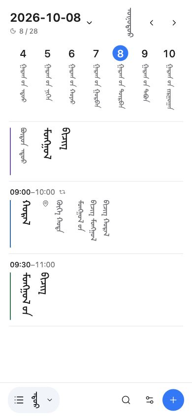
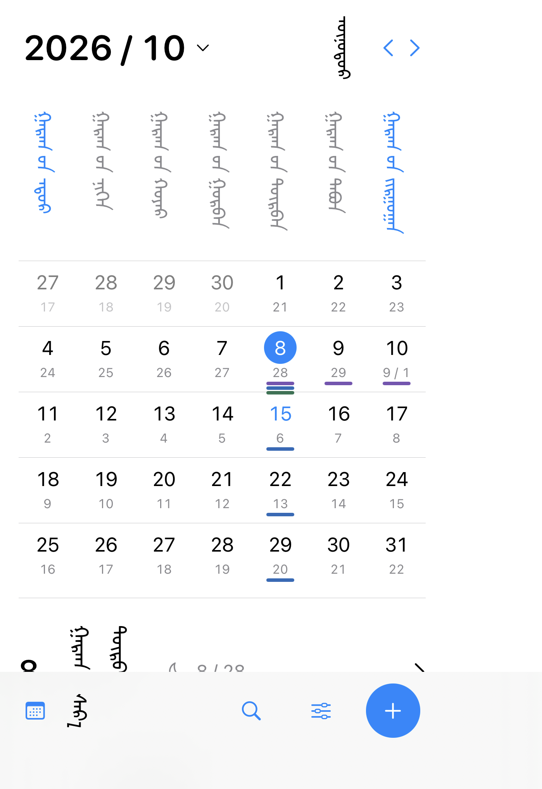

<div align="center">

# Nutug

**以传统蒙古文，安排日常，阅读历史。**

日历与编年历史，两套独立应用。为竖排蒙古文设计的阅读与交互。

**Web · macOS · iPhone · iPad**

[快速开始](#快速开始) · [功能](#功能) · [外观](#外观与个性化) · [开发文档](#开发文档) · [构建状态](https://github.com/Vles0123/nutug/actions)

</div>

---

## 界面预览

<p align="center">
  
  &nbsp;&nbsp;
  
</p>

<p align="center"><sub>网页日程与 iPhone 月历的实际开发预览。画面使用测试日程。</sub></p>

## 功能

|                | Nutug 日历                                           | Nutug 历史                                 |
| -------------- | ---------------------------------------------------- | ------------------------------------------ |
| **主要用途**   | 查看日期，安排个人日程                               | 按年代阅读事件，了解人物与关系             |
| **浏览方式**   | 年、月、周、日视图，日期跳转与搜索                   | 时期目录，年份与人物搜索，事件详情         |
| **核心能力**   | 公历与双历显示，全天、跨天、重复日程，单次修改与撤销 | 事件来源、关联人物、人物关系及来源版本记录 |
| **保存与更新** | 日程保存在本机，通过 ICS 文件导入、导出              | 内容独立发布，联网检查更新，下载后离线阅读 |

**传统蒙古文优先。** 界面使用传统蒙古文；文字从上到下书写、各列从左向右接续。日程按时间上下排列，标题、地点和备注在每条日程内连续阅读。网页与原生端共用日期规则、界面词表和本地字体。

双历模式在公历旁显示中国农历日期，当前日期范围为 **1901–2100 年**。历法、文件互通及各项功能的详细范围见[产品说明](docs/product-scope.md)。

## 快速开始

### 网页

准备 **Node.js 24**，在包含 `package.json` 的仓库根目录执行：

```sh
npm ci
npm run dev
```

| 应用     | 本地地址                               |
| -------- | -------------------------------------- |
| 日历     | <http://127.0.0.1:8000/calendar.html>  |
| 编年历史 | <http://127.0.0.1:8000/chronicle.html> |

开发命令同时启动网页和本地内容服务。使用 nvm 时，可先执行 `nvm use`。其他兼容版本见 [`package.json`](package.json)。

### macOS、iPhone 与 iPad

在 macOS 上安装 Xcode，准备应用资源后打开工程：

```sh
npm ci
npm run build:native
open apple/Nutug.xcodeproj
```

选择 `NutugCalendar` 或 `NutugHistory` scheme，再选择 Mac 或 iPhone/iPad 模拟器运行。真机签名与发行配置见 [Apple 应用指南](docs/apple-app.md)。

## 外观与个性化

在日历的**设置 → 外观**中切换皮肤。应用内入口使用蒙古文。

| 预设     | 风格               |
| -------- | ------------------ |
| **明亮** | 白色背景，蓝色强调 |
| **深色** | 深色背景，浅色文字 |
| **纸面** | 暖色纸面，棕色强调 |
| **黑白** | 单色界面，清晰对比 |

网页日历和 Apple 应用均支持四种预设，自动保存选择，并支持阅读字号调整。

**个性化范围：** 已实现预设皮肤切换；自定义配色、个人皮肤保存、皮肤文件导入与导出属于待开发功能。

## 构建与部署

| 目标                | 命令                    | 输出                                        |
| ------------------- | ----------------------- | ------------------------------------------- |
| 检查代码与行为      | `npm run check`         | 格式检查与回归测试                          |
| 构建独立网页应用    | `npm run package:web`   | `build/web/calendar/`、`build/web/history/` |
| 准备 Apple 应用资源 | `npm run build:native`  | `apple/Resources/public/`                   |
| 构建内容更新        | `npm run build:content` | `content-dist/`                             |

两个网页目录可分别部署到静态站点。正式站点使用 HTTPS，以启用界面离线缓存。Apple 应用通过 Xcode 构建与签名。

历史资料通过独立 JSON 接口更新，界面与内容分别发布。自托管内容源、版本更新和缓存方式见[内容接口文档](docs/content-api.md)。

<details>
<summary><strong>技术栈与目录</strong></summary>

- **网页：** React、React Aria Components、Motion、Lucide、D3。
- **Apple：** SwiftUI、CoreText、JavaScriptCore、WebKit。
- **共享：** 日期与日程规则、传统蒙古文词表、字体和内容格式。
- **验证：** Node.js 回归测试、Apple 构建及原生渲染检查。

```text
src/              网页组件与样式
shared/           日期、日程与内容规则
apple/            SwiftUI 应用与 Xcode 工程
content-source/   历史资料、人物关系与引用
public/           网页静态资源与本地字体
tests/            网页、数据与原生检查
scripts/          构建、预览与内容发布
docs/             开发、设计与来源文档
```

源码直接在上述目录开发。上游交接快照见 [v124 整合记录](docs/upstream-v124.md)与 [v127 原始交接文档](docs/upstream/v127/README.md)。

</details>

## 开发文档

| 想了解什么           | 从这里开始                                                                       |
| -------------------- | -------------------------------------------------------------------------------- |
| 当前功能与后续范围   | [产品说明](docs/product-scope.md)                                                |
| 模块关系与技术架构   | [架构说明](docs/architecture.md)                                                 |
| 竖排阅读、输入与字形 | [蒙古文交互](docs/mongolian-interaction.md) · [字体说明](FONT-NOTES.md)          |
| 界面与组件约定       | [界面设计](docs/interface.md)                                                    |
| 原生构建与签名       | [Apple 应用](docs/apple-app.md)                                                  |
| 内容发布与设备接入   | [内容接口](docs/content-api.md)                                                  |
| 历史收录范围与引用   | [历史编排](docs/history-coverage.md) · [来源记录](docs/history-source-review.md) |
| 提交改动与参与开发   | [贡献指南](CONTRIBUTING.md)                                                      |

## 内容与许可

历史内容持续扩充，来源记录保留英文与西里尔蒙古语 Wikipedia 的页面及修订信息。蒙古文审校进度见[界面词形记录](docs/calendar-language-review.json)和[翻译核对记录](docs/menksoft-review.json)。

原创代码与编辑内容的授权标识为 **UNLICENSED**，使用授权由权利人确定。第三方组件和字体保留各自许可，详见 [THIRD_PARTY_NOTICES.md](THIRD_PARTY_NOTICES.md)。
